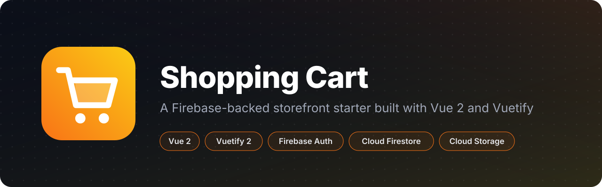
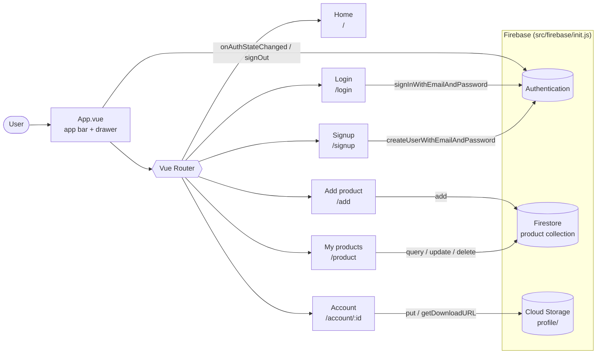

<div align="center">
  
  <p><b>A Firebase-backed storefront starter: authentication, product management and image uploads in a Vue 2 + Vuetify single-page app.</b></p>
  <p>
    
    
    
    
    <a href="LICENSE"></a>
    <a href="https://github.com/ismailbentabett/shopping-cart-vue-vuetify-firebase/stargazers"></a>
    
    
  </p>
  <p><a href="#-quick-start">Quick start</a> · <a href="#-features">Features</a> · <a href="#-architecture">Architecture</a> · <a href="#-contributing">Contributing</a></p>
</div>

## Overview

**Shopping Cart** is a reference implementation of a serverless storefront back office built with Vue 2, Vuetify and Firebase. Signed-in users manage their own product catalogue in Cloud Firestore and upload images to Cloud Storage, with Firebase Authentication handling identity, so the whole app runs without a custom backend. It is a compact case study in wiring a Material Design SPA directly to Firebase services.

## ✨ Features

| Feature | Description |
| --- | --- |
| **Email/password authentication** | Sign up, log in and log out with Firebase Authentication; the app bar and navigation drawer react to auth state in real time. |
| **Add products** | Create a product with name, category and price; it is stored in the Firestore `product` collection and linked to the owner's `user_id`. |
| **My products** | Lists only the signed-in user's products (Firestore `where("user_id", "==", uid)` query) as Vuetify cards with a live product count. |
| **Edit and delete** | Update a product's name, category and price in a full-screen dialog, or delete it from Firestore. |
| **Image upload with progress** | The account page uploads an image to Cloud Storage (`profile/` path) with a circular progress indicator and returns the download URL. |
| **Material Design UI** | Vuetify 2 app bar, navigation drawer, parallax hero with a search field and an image carousel on the home page. |
| **Client-side routing** | Vue Router in history mode with dedicated routes for home, auth, account and product management. |

## 🧱 Tech stack

| Layer | Technology |
| --- | --- |
| Framework | [Vue 2.6](https://v2.vuejs.org/) (Options API) |
| UI | [Vuetify 2](https://v2.vuetifyjs.com/) with Material Design Icons |
| Routing | [Vue Router 3](https://v3.router.vuejs.org/) (history mode) |
| Authentication | Firebase Authentication (email/password) |
| Database | Cloud Firestore |
| File storage | Cloud Storage for Firebase |
| SDK | Firebase JS SDK 7.x |
| Tooling | Vue CLI 4.4, Babel, ESLint (`plugin:vue`), Sass, `vuetify-loader`, `lint-staged` |

## 🏗 Architecture

The app is a pure client-side SPA. Every view talks to Firebase through a single initialized app instance exported from `src/firebase/init.js`.



```text
shop/src/
├── App.vue                  # Shell: app bar, auth-aware navigation drawer, sign-out
├── main.js                  # Vue bootstrap (router + Vuetify)
├── firebase/init.js         # Firebase app initialization
├── plugins/vuetify.js       # Vuetify + Material Design Icons
├── router/index.js          # Route table
└── components/
    ├── Home.vue             # Hero, search field, carousel
    ├── auth/                # Login.vue, Signup.vue
    └── account/             # Account.vue (upload), Addproduct.vue, Myproduct.vue
```

## 🚀 Quick start

### Prerequisites

- [Node.js](https://nodejs.org/) LTS and npm. The toolchain is Vue CLI 4 / webpack 4, so Node 14 or 16 gives the smoothest experience. On Node 17+ you may need `NODE_OPTIONS=--openssl-legacy-provider`.
- A [Firebase](https://console.firebase.google.com/) project with **Email/Password** sign-in, **Cloud Firestore** and **Cloud Storage** enabled (only needed if you want to use your own backend).

### Install and run

```bash
# 1. Clone
git clone https://github.com/ismailbentabett/shopping-cart-vue-vuetify-firebase.git
cd shopping-cart-vue-vuetify-firebase/shop

# 2. Install dependencies
npm install

# 3. Start the dev server (http://localhost:8080 by default)
npm run serve
```

### Production build

```bash
npm run build   # outputs to shop/dist
```

Because the router uses history mode, configure your host to rewrite unknown paths to `index.html` (for Firebase Hosting, add a `"rewrites": [{ "source": "**", "destination": "/index.html" }]` rule).

## ⚙️ Configuration

Firebase is configured in [`shop/src/firebase/init.js`](shop/src/firebase/init.js) through a standard Firebase web config object whose values are read from `VUE_APP_FIREBASE_*` environment variables. Copy [`shop/.env.example`](shop/.env.example) to `shop/.env.local` and fill it with the values from **Firebase console → Project settings → Your apps → Web app**:

| Key | Description |
| --- | --- |
| `apiKey` | Web API key of your Firebase project |
| `authDomain` | Auth domain, usually `<project-id>.firebaseapp.com` |
| `databaseURL` | Realtime Database URL (kept for SDK compatibility) |
| `projectId` | Firebase project ID |
| `storageBucket` | Cloud Storage bucket |
| `messagingSenderId` | Cloud Messaging sender ID |
| `appId` | Firebase web app ID |

`.env.local` is git-ignored, so your keys stay out of the repository.

**Data model used by the app**

| Service | Location | Shape |
| --- | --- | --- |
| Firestore | `product/{docId}` | `{ name, categories, price, user_id }` |
| Cloud Storage | `profile/{fileName}` | Uploaded image file |

Lock these down with Firestore and Storage security rules so users can only read and write their own data. See [SECURITY.md](SECURITY.md).

## 📁 Project structure

```text
.
├── .github/                 # Branding assets, issue and PR templates
├── shop/                    # Vue CLI application
│   ├── public/              # index.html, favicon
│   ├── src/                 # Application source (see Architecture)
│   ├── babel.config.js
│   ├── vue.config.js        # Transpiles Vuetify
│   └── package.json         # Scripts: serve, build, lint
├── CONTRIBUTING.md
├── CODE_OF_CONDUCT.md
├── SECURITY.md
└── LICENSE
```

## 🗺 Roadmap

- [ ] Shopping cart state (add to cart, quantities, totals) and a cart drawer
- [ ] Public product catalogue on the home page with working search and category filters
- [ ] Attach uploaded images to products and show them on product cards
- [x] Move Firebase config to `VUE_APP_*` environment variables with a `.env.example`
- [ ] Ship Firestore and Storage security rules in the repository
- [ ] Form validation and user-facing error messages for auth and product forms
- [ ] Centralized state with Vuex or Pinia
- [ ] Unit tests (Vue Test Utils) and a CI workflow
- [ ] Upgrade path to Vue 3, Vuetify 3 and the modular Firebase SDK

## 🤝 Contributing

Contributions are welcome. Read the [Contributing guide](CONTRIBUTING.md) for setup, scripts and the pull request workflow, and follow the [Code of Conduct](CODE_OF_CONDUCT.md).

## 🔒 Security

Please report vulnerabilities privately through GitHub's Security tab. Details are in [SECURITY.md](SECURITY.md).

## 📄 License

Released under the [MIT License](LICENSE).

---

<div align="center">
  <p>Built by <a href="https://github.com/ismailbentabett">Ismail Bentabett</a> · <a href="https://ismailbentabett.com">ismailbentabett.com</a></p>
  <p>⭐ Star this repo if you find it useful</p>
</div>
